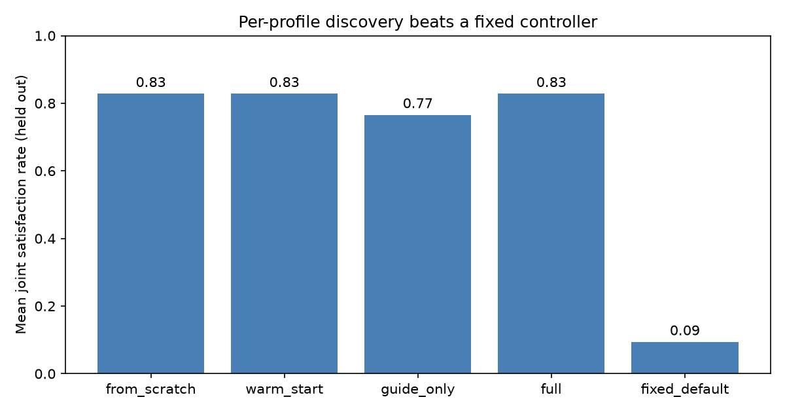
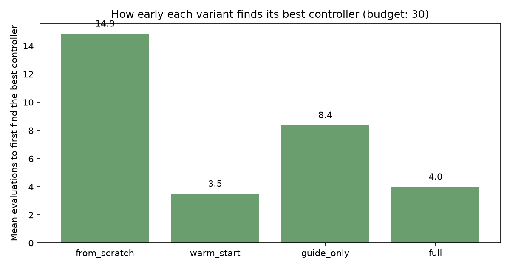
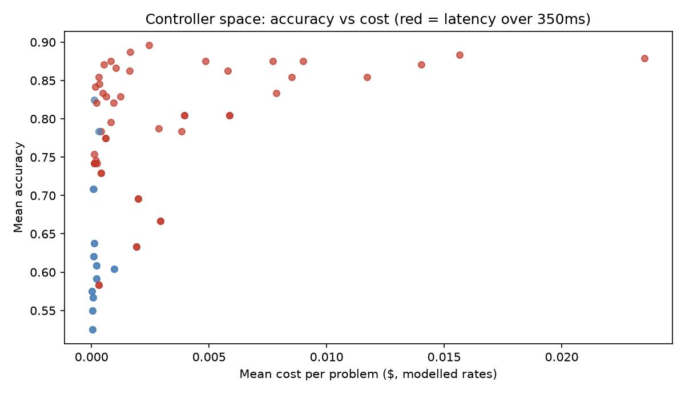

# Amortized Personalized Test-Time Scaling

Discover a test-time-scaling controller for each user profile — not one
controller for everyone, and not a fresh search for every user.

A user profile states three requirements jointly: an accuracy floor and
ceilings on latency and cost. A controller satisfies a profile only
when all three hold at once. This repository implements the
formulation from Wang et al., "From Pareto to Preference: Personalized
Test-Time Scaling via Amortized Agentic Policy Discovery"
(arXiv:2610.09684, October 2026), and measures whether reusing prior
discovery experience — a retrieved source controller plus a frozen
Guide distilled from source histories — finds satisfying controllers
with fewer candidate evaluations than searching from scratch.

This is an independent implementation written from the paper's
formulation. It runs entirely on CPU on a synthetic testbed: the
reasoning problems are generated multi-step arithmetic with known
ground truth, and controllers are evaluated by replaying a pre-sampled
trajectory bank, the same evaluation design the paper uses (128
pre-sampled trajectories per problem-model pair). Its numbers describe
controller discovery on that testbed. They are not the paper's AIME /
HMMT results with Qwen3 models, and the trajectory simulator's rates
are modelled parameters, not vendor prices. See
[`docs/RESEARCH.md`](docs/RESEARCH.md) for sources and for what was
deliberately not claimed.

## The idea in one paragraph

Optimising a single Pareto frontier — accuracy against cost, or
accuracy against latency — can pick a controller that fails the
requirement it never looked at. The joint satisfaction rate fixes the
objective: the fraction of evaluation seeds on which a controller
meets the accuracy, latency and cost requirements simultaneously.
Discovery is then amortised across users. Source profiles are solved
once and stored in an experience bank with their search histories; a
new profile retrieves the most similar source profile's controller,
re-evaluates it under its own requirements, and searches onward with
neighbour proposals ordered by a frozen Guide distilled from the
source histories. Every candidate is always evaluated under the
target profile — reuse changes where the search starts and in what
order it looks, never what counts as satisfying the user.

## Controllers

A controller coordinates the decisions the paper's executable
controllers make:

| Knob | Values | Meaning |
| --- | --- | --- |
| `tier` | small / medium / large | Simulated model tier: accuracy rises, latency and cost rise with it |
| `width` | 1 / 2 / 4 / 8 | Samples drawn per pass; majority vote decides the answer |
| `passes` | 1 / 2 / 3 | Sequential passes; a later pass overturns an earlier answer only on a unanimous vote |
| `early_stop` | off / on | Stop a pass once the first two samples agree, instead of consuming the full width |

72 controllers in total. Modelled tier rates:

| Tier | Per-step slip probability | Cost per 1M tokens | Latency per token | Tokens per step |
| --- | --- | --- | --- | --- |
| small | 0.075 + 0.018 per difficulty step | $0.20 | 0.55 ms | 28 |
| medium | 0.045 + 0.018 per difficulty step | $0.80 | 0.85 ms | 36 |
| large | 0.022 + 0.018 per difficulty step | $6.00 | 1.25 ms | 45 |

A trajectory simulates step-by-step reasoning: at each step the
solver may slip, and later steps build on the slipped value, so errors
accumulate — which is what makes width, passes and early stopping
matter. Single-sample accuracy on the trajectory bank, measured over
120 problems × 32 trajectories per tier: small 0.52, medium 0.60,
large 0.65. Majority voting over 8 samples lifts the best controller
on the discovery set to 0.89, which is the whole point of test-time
scaling.

## Discovery variants

- `from_scratch` — hill-climbing from a fixed default controller.
- `warm_start` — hill-climbing from the retrieved source controller.
- `guide_only` — hill-climbing from the Guide's recommendation, with
  Guide-ordered neighbour proposals, and no retrieved controller.
- `full` — warm start plus Guide-ordered proposals.
- `oracle` — exhaustive evaluation of all 72 controllers (an upper
  bound for reporting regret, not a discovery method).
- `fixed_default` — the same default controller for every profile.

The search is first-improvement hill-climbing over single-knob
neighbours with seeded random restarts until the candidate budget is
spent. The search score is the joint satisfaction rate, with a graded
partial-satisfaction term and mean accuracy breaking ties — the raw
rate is too coarse to guide search when no candidate satisfies a
profile on any seed, and without the graded term the search
degenerates to the cheapest controller. The reported rate is always
the pure joint satisfaction rate.

The single-frontier comparison picks, by exhaustive evaluation on the
discovery set (72 evaluations, more than the discovery budget of 30),
the controller that best satisfies accuracy+cost only, or
accuracy+latency only, then judges it on the held-out set by the full
joint rate.

## Measured results

Run with `python scripts/run_experiment.py` (seed 0; 120 problems, 60
discovery / 60 held out, 24 source profiles, 8 unseen target profiles,
30-candidate discovery budget, 4 discovery seeds, 8 held-out seeds).
All figures below are from `results/experiment.json` in this
repository, produced by that run.

| Variant | Mean held-out joint satisfaction rate | Mean evaluations to first find its best controller | Candidates spent |
| --- | --- | --- | --- |
| from_scratch | 0.83 | 14.9 | 30 (full budget) |
| warm_start | 0.83 | 3.5 | 30 (full budget) |
| guide_only | 0.77 | 8.4 | 30 (full budget) |
| full (warm start + Guide) | 0.83 | 4.0 | 30 (full budget) |
| fixed_default | 0.09 | — | — |
| oracle (exhaustive, 72 controllers) | 0.83 | — | 72 |

Every discovery variant spends the full 30-candidate budget — the
search restarts until the budget is spent — so the reuse effect is
not in total candidates spent. It is in how early the best controller
is first found: warm-start discovery finds its eventual best
controller after a mean of 3.5 evaluations, against 14.9 for
from-scratch discovery, because the retrieved source controller is
already the best controller for four of the eight target profiles.
All three of from_scratch, warm_start and full reach the oracle's
held-out rate (0.83) on this testbed; no variant can beat the oracle,
and on the two targets where the oracle itself is 0.62 and 0.50, no
controller in the space satisfies the profile on every held-out seed.

The single-frontier comparison is unambiguous on one side and
instructive on the other. Controllers chosen to optimise
accuracy+cost only score a mean held-out joint satisfaction rate of
0.00 across all eight targets: ignoring latency, they pick
controllers running at 572–1,141 ms, above every target's latency
ceiling. Controllers chosen to optimise accuracy+latency only score
0.77, close to the oracle — because in this calibration cost rarely
binds: the accuracy-latency winners are mostly cheap small- and
medium-tier controllers that pass the cost ceilings anyway, except on
one target where the accuracy-latency winner also fails the joint
rate (0.00). The joint
objective is what protects the dimension a single frontier never
checks; when that dimension happens not to bind, the frontier
looks fine, which is exactly why it cannot be trusted in general.

The Guide, honestly, carries little of the win here. Its distilled
rules barely discriminate in a bank of 24 source histories —
latency-tight profiles used early stopping in 57% of winning
controllers versus 62% otherwise, both accuracy groups favoured the
small tier, and the median winning width was 8 with and without a
tight cost ceiling — and guide_only is the one variant that misses
the oracle, scoring 0.77 by choosing a worse controller on one
target. Guide-ordered proposals do find their best controller
earlier than from-scratch search (8.4 evaluations), but the
retrieval step, not the Guide, is what makes warm_start and full
fast. That matches a caveat in the paper itself: enlarging the
experience bank does not always help, and the headline gains come
mostly from the joint objective.

## Figures





## Quickstart

```bash
pip install -r requirements.txt
pip install -e .
python scripts/demo.py            # one target profile, from-scratch vs full
python scripts/run_experiment.py  # the full experiment; writes results/
python -m pytest -q               # tests
```

The demo discovers a controller for one profile with and without
reuse, prints both held-out results, and prints the distilled Guide
rules. The experiment takes about two minutes on CPU and writes
`results/experiment.json`, `results/experience_bank.json`,
`results/guide.json` and the figures above.

## Layout

```
src/persontts/
  problems.py        generated multi-step problems, stratified split
  trajectories.py    pre-sampled trajectory bank and tier rates
  controllers.py     executable controllers and replay evaluation
  profiles.py        user profiles and the joint satisfaction rate
  experience_bank.py source histories and nearest-profile retrieval
  guide.py           frozen Guide distilled from source histories
  discovery.py       hill-climbing discovery variants and the oracle
  evaluation.py      fixed-default and single-frontier baselines
  plotting.py        figures
scripts/
  demo.py            one-profile demo
  run_experiment.py  source discovery, Guide distillation, target evaluation
tests/               determinism, calibration, discovery, end-to-end
docs/RESEARCH.md     sources checked and what they do (and do not) support
examples/profiles.json  example requirement profiles
```

## Scale-up path

Replace the trajectory simulator with real rollouts and keep the
interfaces: `Controller`, `UserProfile`, the joint satisfaction rate
and the discovery variants are all defined over evaluated controllers,
not over how trajectories were produced. The natural stack is the one
the paper's evaluation uses: Qwen3-class models served through vLLM,
controllers trained or searched with TRL's GRPOTrainer, trajectories
pre-sampled once per problem-model pair, and the same
discovery/held-out split. A discovered controller is then a serving
decision policy — model, width, passes, stopping rule — of the kind a
decision-policy API evaluates per request. No GPU run was performed
for this repository; that path is a design note, not a result.

## Limitations

- The trajectory simulator is a model of reasoning, not a model doing
  reasoning: per-step slip probabilities are parameters, so absolute
  accuracies do not transfer to real models or benchmarks.
- Profiles, problems and rates are synthetic and chosen so the
  trade-offs bind; a different calibration can move every number.
- The Guide is distilled from 24 source profiles in this testbed;
  with so few histories its rules are coarse, and enlarging the bank
  does not always help (the paper reports the same non-monotonicity
  on HMMT).
- Discovery is hill-climbing, not the paper's LLM discovery agent:
  the comparison isolates reuse and ordering, not agent quality.

## References

- Wang, X., Liu, Z., Zheng, T., Feng, S., Yuan, P., Li, Y., Shi, J.,
  Zhang, Y., Tan, C., Zhang, J., Pan, B., and Li, K. "From Pareto to
  Preference: Personalized Test-Time Scaling via Amortized Agentic
  Policy Discovery." arXiv:2610.09684, 2026.
  https://arxiv.org/abs/2610.09684
- Dou, Z., Luo, K., Li, C., Lu, S., and Liu, Z. "FALCA:
  Falsification-Aware Reinforcement Learning with Hierarchical Credit
  Assignment for Long-Horizon Deep Search Agents." arXiv:2610.28361,
  2026. https://arxiv.org/abs/2610.28361
- Cui, Y., et al. "MaD-RSI: Model-as-Data for Recursive Self-Improvement
  of Agent Harnesses." arXiv:2610.28201, 2026.
  https://arxiv.org/abs/2610.28201

## License

MIT. See `LICENSE`.
